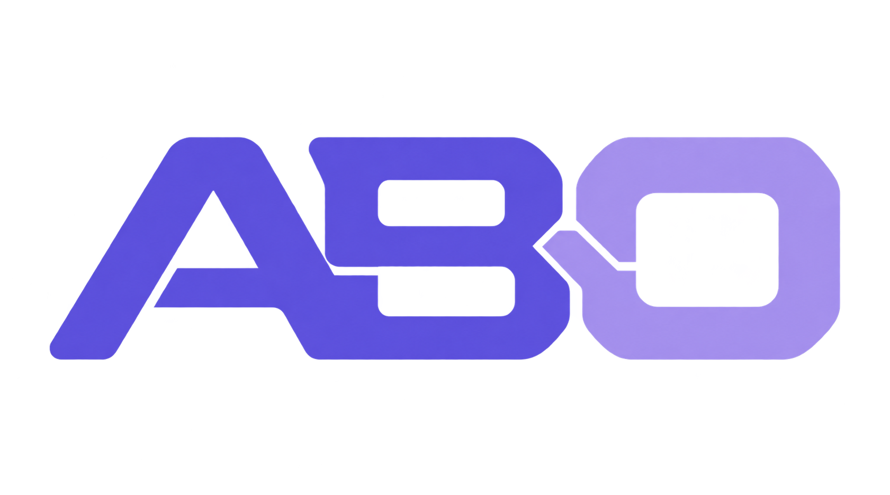

<p align="center">
  
</p>

<h1 align="center">Avatar Build Obfuscator (ABO)</h1>

<p align="center">
  <a href="README.md">中文</a> · <a href="README.ja.md">日本語</a>
</p>

<p align="center">Build-time obfuscation for VRChat avatars, preserving source assets without a runtime decoder.</p>

## Features

- Rename resources, objects, bones, parameters, Animator internals and dynamic BlendShapes using your username plus `Ì/Í/Î/Ï` symbols.
- Bake and remove supported fixed/unused BlendShapes and zero-delta shapes, while retaining required dynamic shapes.
- Independently shuffle BlendShape, sibling GameObject, mesh vertex and skin bone-palette order, updating related references.
- Randomize each build and write local processing reports; optionally embed multilingual authorization notices and build fingerprints.

## Install

Requires **Unity 2022.3, Avatar SDK 3.7.0+ and NDMF 1.14.8+**. Install the SDK and [NDMF](https://github.com/bdunderscore/ndmf) in your package manager first.

**[ALCOM](https://vrc-get.anatawa12.com/zh-hans/alcom/) / [VCC](https://vrchat.com/home/download) / [VCL](https://start.gamemode1.com/pages/vrclearnlauncher/) (recommended)**

1. Open the [package repository page](https://akanecoo.github.io/AvatarBuildObfuscator/) and add the repository using its button, or paste the listed repository URL into your manager.
2. Select your project in the manager and install **Avatar Build Obfuscator** from its package list. Enable prereleases for beta versions.
3. Return to Unity and add the component as described under [Use](#use).

The repository page also links the official NDMF repository. **Choose one installation method to avoid duplicate copies.**

<details>
<summary>Git, unitypackage and migration</summary>

**Git:** Open **Window → Package Manager → ＋ → Add package from git URL…** and enter:

```text
https://github.com/AKaNecoo/AvatarBuildObfuscator.git?path=/Packages/dev.avatar-tools.build-obfuscator#main
```

Use `#beta` for test releases.

**unitypackage:** Download and import a `.unitypackage` from [Releases](https://github.com/AKaNecoo/AvatarBuildObfuscator/releases).

**Moving to VPM:** First remove a Git installation in Package Manager, then install through ALCOM, VCC or VCL. VPM can migrate legacy `.unitypackage` folders by GUID. Keep your own model assets outside the plugin folder; retain the component settings on your avatar.

</details>

## Use

1. Select the avatar root in **Hierarchy**. At the bottom of **Inspector**, click **Add Component**, search for **Avatar Build Obfuscator** and add it.
2. Confirm or enter your username and choose a mode.
3. Build normally with the VRChat SDK. Inspect the build copy; original Hierarchy and Project names stay unchanged.

| Mode | Behavior |
| --- | --- |
| Conservative (default) | Prioritizes compatibility and preserves dependencies it cannot verify. |
| Aggressive | Expands obfuscation coverage and accepts unknown compatibility risks; test functionality and external integrations before use. |

**What to expect:** Conservative mode prioritizes compatibility, so its changes may be less noticeable. Aggressive mode covers more and usually produces more noticeable obfuscation, with higher compatibility risks.

**For MMD expressions, keep both Obfuscate MMD expressions and Rename MMD objects off.** Object renaming changes paths such as `Body` and can break MMD expressions.

<details>
<summary>More settings and build checks</summary>

- The component supports Simplified Chinese, English and Japanese. Switch operations independently or use preservation lists to skip selected Renderer operations.
- **Subtree mode overrides** let body, clothing and accessories use separate modes. Presets store only operation switches and mode. See the [implementation guide](ARCHITECTURE.md) for shared-resource and other detailed rules.
- **Show latest build report** searches processing records and preservation reasons, and checks notices/fingerprints. Console messages prefixed with `[Avatar Build Obfuscator]` also report processing counts and preservation reasons.
- **Test build and comparison** creates temporary copies for sampled checks and cleans them when the window closes; sampling does not replace VRChat functionality tests.
- Experimental **UV/texture rotation** and **synchronized-shape merging** default off. See the [compatibility matrix](ARCHITECTURE.md#exact-pruning-and-experimental-transforms) for supported configurations.

</details>

## Notes

- **Public prefix:** Up to 32 characters of your username appear in build output names. New components default to an existing avatar ID; edit it freely, or enter a username if no ID exists. Change it before building if you do not want to publish that value.
- **Download size:** Obfuscation may increase the avatar's download size, and experimental texture rotation may increase it further. Check the SDK build statistics before uploading.
- **Protection limits:** Obfuscation does not guarantee protection against extraction. Texture pixels, final geometry and required dynamic BlendShapes remain extractable.
- **Authorization notice:** Declared rights holders and contacts are published with the notice. It does not authenticate ownership or guarantee that AI will refuse to assist in reverse-engineering the model.

## Update

- **VPM:** Update in ALCOM, VCC or VCL.
- **Git / unitypackage:** Use the component's version/update panel; Git also supports Package Manager.
- Automatic checks default on; automatic installation defaults off. Package-based updates remove temporary downloads afterward.

<details>
<summary>Switching Git channels</summary>

`#main` and `#beta` update independently and do not switch channels automatically. To move from beta to stable, add the same Git URL ending in `#main` again in Package Manager; existing component settings are retained.

</details>

## Feedback and documentation

Report bugs through [GitHub Issues](https://github.com/AKaNecoo/AvatarBuildObfuscator/issues) or [kiinemaki@qq.com](mailto:kiinemaki@qq.com). Include your ABO/Unity versions, mode, reproduction steps and relevant log excerpts.

[Detailed rules and implementation](ARCHITECTURE.md) · [Validation scope](TESTING.md) · [Changelog](CHANGELOG.md) · [GPL-3.0 license](LICENSE)

From 0.5.0, licensed under GPL-3.0-only. Earlier published versions retain their MIT license; dependencies keep their own terms.

Inspired by name-obfuscation ideas in [cocokoishi/AvatarObfuscator](https://github.com/cocokoishi/AvatarObfuscator), with independently maintained build-copy handling, reference remapping and compatibility rules.
